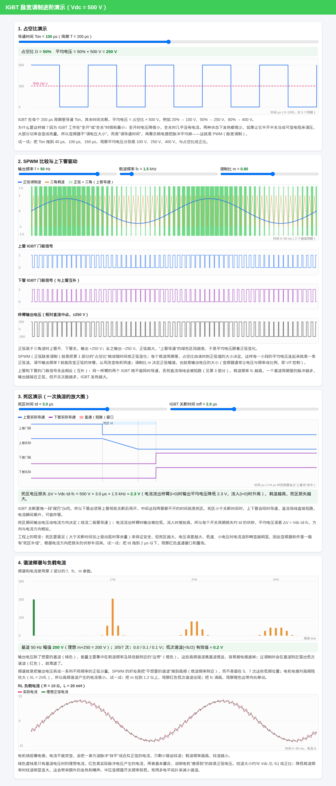

# IGBT PWM / SPWM 交互演示

一个用浏览器打开的单文件网页，用来看懂变频器里 IGBT 怎样用「全开 / 全关」把直流母线变成近似正弦的交流。母线电压固定为 **500 V**。拖动滑块，下面的图会跟着重画。

页面分成四块：

1. **占空比**：一个 200 μs 周期里导通多久，平均电压就是占空比 × 500 V。
2. **SPWM**：正弦调制波和三角载波比较，得到上管、下管门极，以及桥臂输出 ±250 V。
3. **死区**：换流时先让上下管都关掉一小段时间，避免直流母线短路。死区比关断时间还短时，图上会出现直通警告。
4. **谐波频谱和 RL 电流**：电压能量集中在哪些频率，以及电感怎样把一串方波脉冲抹成接近正弦的电流。

更早、更短的一版放在 [`v1/spwm_demo.html`](v1/spwm_demo.html)：只有斩波、SPWM 和电流，没有死区和频谱。两版都是单个 HTML 文件，不下载任何外部库。



## 怎么打开

### 下载后双击

1. 在本仓库页面点 **Code → Download ZIP**，解压。
2. 双击解压出来的 `index.html`（旧版则双击 `v1/spwm_demo.html`）。
3. 用 Chrome、Edge 或 Firefox 打开即可。计算全在你自己的浏览器里完成，不需要安装软件，也不需要联网。

### 放到 GitHub Pages 上

合并到 `main` 之后：

1. 打开仓库的 **Settings → Pages**。
2. **Build and deployment** 里，Source 选 **Deploy from a branch**。
3. Branch 选 **main**，文件夹选 **/ (root)**，保存。
4. 等一两分钟。页面地址一般是：

   <https://gushenbusishiweixuanpin.github.io/pwm-demo/>

旧版地址是同一网址后面加上 `v1/spwm_demo.html`。

地址栏还可以带参数，方便把某一张图单独摆出来，例如 `index.html?f=30&m=1.2&solo=4`。`solo` 取 1 到 4，只显示对应的那一张卡片。平时双击打开不用管这个。

## `index.html` 里的代码是怎么摆的

整个程序就是根目录这一个文件，从上到下三块。文件开头的注释也写了同样的话。

### HTML：页面上有什么

`<body>` 里面是看得见的内容：绿色标题栏，然后四张白色卡片（`<section class="card">`）。每张卡片里有说明段落、滑块（`<input type="range">`）和画布（`<canvas>`）。

JavaScript 靠 `id` 找到这些元素。对应关系是：

| 卡片 | 滑块 id | 画布 id | 计算函数 |
| --- | --- | --- | --- |
| 1 占空比 | `ton` | `c1` | `m1` |
| 2 SPWM | `f`、`fc`、`m` | `c2` 比较，`c2u` 上管，`c2l` 下管，`c2o` 输出电压 | `m2` |
| 3 死区 | `td`、`toff` | `c3` | `m3` |
| 4 频谱和电流 | 沿用上面的 `f`、`fc`、`m` | `c4` 频谱，`c5` 电流 | `m4` |

滑块旁边的 `<b id="tonv">` 这类标签，用来显示当前数值。绿色读数条的 id 是 `r1`、`r3`、`r4`。过调制黄条是 `om`，直通红条是 `st`，平时藏着，条件满足才显示。

### CSS：长什么样

都在 `<head>` 里的 `<style>` 中。这里规定底色、顶栏绿色、卡片圆角、滑块排成几列、画布高度、警告条的颜色。改这里只改外观，不改计算结果。带 `class="s"` 的画布矮一些，用来画门极和桥臂电压。

### JavaScript：怎么算、怎么画

都在文件底部的 `<script>` 里。可以分成「几个小工具」和「四张图」。

小工具：

- `$('ton')` 是 `document.getElementById('ton')` 的简写。滑块读出来的是文字，前面加 `+` 就变成数字，例如 `+$('ton').value`。
- `prep`：按屏幕清晰度设置画布的像素大小，返回画笔 `g` 和宽高。
- `axes`：画网格和刻度，并给出两个换算函数 `X`、`Y`，把「微秒、伏特」换成「屏幕上的像素」。
- `line`：把一串点连成折线。最后一个参数可以指定虚线，平均电压和理想电流用的就是虚线。
- `tri`：给定时刻 `t` 和载波频率 `fc`，算出三角波此时的高度，范围在 −1 到 +1。
- `fft`：快速傅里叶变换。把一段电压波形拆成许多不同频率的正弦分量。只有第 4 张图用它。
- `P`：一次读出第 2 部分的三个滑块。`f` 是 Hz，`fc` 滑块单位是 kHz，这里乘 1000 变成 Hz，`m` 是调制比。

滑块接在文件最下面几行：

- 拖 `ton`，只重画第 1 张图（`m1`）。
- 拖 `f`、`fc` 或 `m`，重画第 2、3、4 张图。死区损失和频谱都用到载波频率，所以载波一变，这三张都要更新。
- 拖 `td` 或 `toff`，只重画死区那张图（`m3`）。
- 浏览器窗口变大变小，四张图全部重画（`all`），否则画布会发糊或留白。

### 第 1 张图（`m1`，画布 `c1`）

周期固定 200 μs。占空比 `D = Ton / 200`。在 0～1000 μs（5 个周期）上取大约 3000 个点：当前时间对 200 取余数，小于 Ton 时电压是 500 V，否则是 0。红色虚线是平均电压 `D × 500`。

### 第 2 张图（`m2`）

时间长度是 2 个基波周期，`T = 2 / f`。每个采样点算一次正弦 `m·sin(2πft)` 和三角载波。正弦高于三角时，上管门极为 1、下管为 0、桥臂输出 +250 V（相对直流中点）；否则上管 0、下管 1、输出 −250 V。比较图里的绿色色块就是上管导通的时段。`m > 1` 时显示出过调制提示。

### 第 3 张图（`m3`，画布 `c3`）

把一次换流放大到 0～16 μs，`t = 4 μs` 时控制器命令上管关断。上管电流按关断时间 `toff` 从 1 线性降到 0；下管要等死区 `td` 过完才开。`td < toff` 时，两管重叠的那一段涂成红色，并显示直通警告。下面的读数是死区带来的平均电压损失：`ΔV ≈ 500 × td × fc`（`td` 先换成秒）。

### 第 4 张图（`m4`，画布 `c4` 和 `c5`）

频谱：取一个基波周期、32768 个点的桥臂电压（只有 +250 V 和 −250 V 两档），交给 `fft`。第 n 次谐波的频率是 `n × f`，幅值是 `2 × 该分量的模 / 点数`。基波画成绿色；频率低于 `fc / 2` 的低次谐波画成红色；其余（载波及其倍数附近的边带）画成橙色。

电流：电机简化成 `R = 10 Ω`、`L = 20 mH`。用欧拉法一步步解 `L·di/dt = v − R·i`。先空转两个周期，把上电瞬间的暂态走掉，再画出接下来两个周期。红色是脉冲电压产生的实际电流，绿色虚线是只保留基波电压时的理想正弦电流。

## 名词小表

| 词 | 在这页里的意思 |
| --- | --- |
| PWM | 脉宽调制。开关只有全开和全关，靠改变导通时间来改变平均电压。 |
| 占空比 D | 一个周期里导通时间所占的比例。这里 `D = Ton / 200 μs`。 |
| IGBT | 页面里的开关管。讨论的是它的门极（开还是关）和桥臂输出电压。 |
| SPWM | 正弦脉宽调制。每个载波周期的占空比按正弦规律变化，平均电压就跟着变成正弦。 |
| 调制波 | 想要的正弦目标，幅值是调制比 `m`。 |
| 载波 `fc` | 用来比较的高频三角波。越高，一个基波周期里的脉冲越多，电流纹波越小，开关损耗越大。 |
| 调制比 `m` | 正弦幅值相对三角波的大小，决定输出电压高低。本页里基波电压大约是 `m × 250 V`。 |
| 过调制 | `m > 1`。正弦峰超出三角波，波峰附近开关不再动作，输出变平，并冒出 3、5、7 次等低次谐波。 |
| 桥臂 | 上下两只 IGBT 串在直流母线正负极之间，中点就是输出。相对母线中点，输出是 +250 V 或 −250 V。 |
| 死区 `td` | 换流时上下管都保持关断的时间，用来躲开关断拖尾造成的同时导通。 |
| 关断时间 `toff` | 命令关断之后，管子电流真正降到零还要拖的那一段。 |
| 直通 | 同一桥臂上下管同时导通，500 V 母线被短路。 |
| 基波 | 想要的那一个频率，就是滑块上的输出频率 `f`。 |
| 谐波 / 边带 | 基波以外的频率分量。SPWM 把大部分多余能量推到载波频率附近，叫边带。 |
| FFT | 快速傅里叶变换。把一段波形拆成各频率的幅值，第 4 张频谱图用的就是它。 |
| V/f | 电压随频率按比例变化，用来在调速时维持电机磁通大致不变。本页用 `f` 和 `m` 两个滑块分开演示。 |
| RL 负载 | 电阻加电感，用来近似电机绕组。电感让电流不能突变，于是脉冲电压变成带小锯齿的正弦电流。 |
| 纹波 | 实际电流相对理想正弦多出来的锯齿。载波越低、电感越小，纹波越大。 |

## 目录

```
index.html            当前版本（v2）。GitHub Pages 会直接打开它
v1/spwm_demo.html     更早的简单版
docs/screenshot_v2.png  v2 整页截图
LICENSE               MIT 许可证
```

## 许可

本仓库使用 [MIT 许可证](LICENSE)。可以自由复制、修改，用于学习和个人项目；再分发时请保留版权声明。
